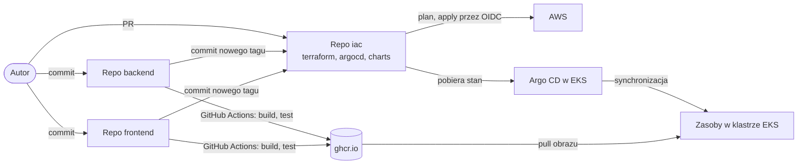
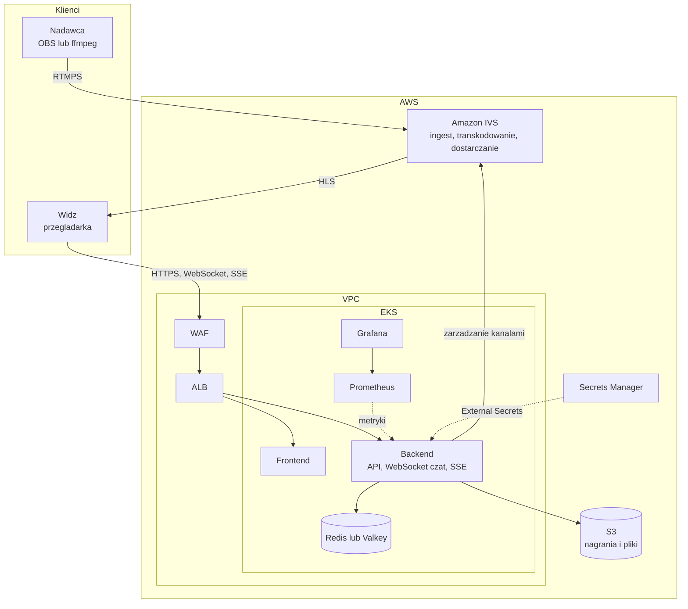
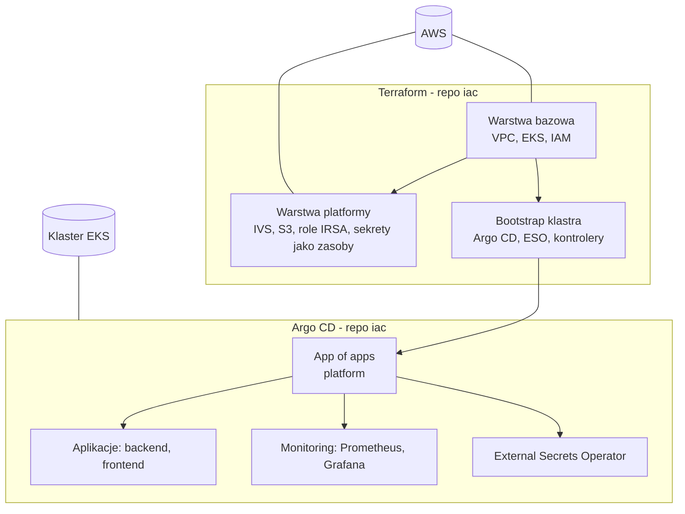
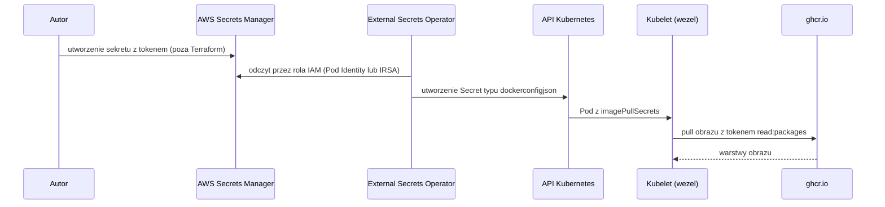
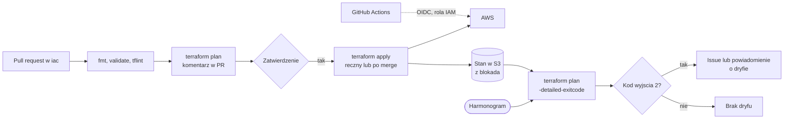
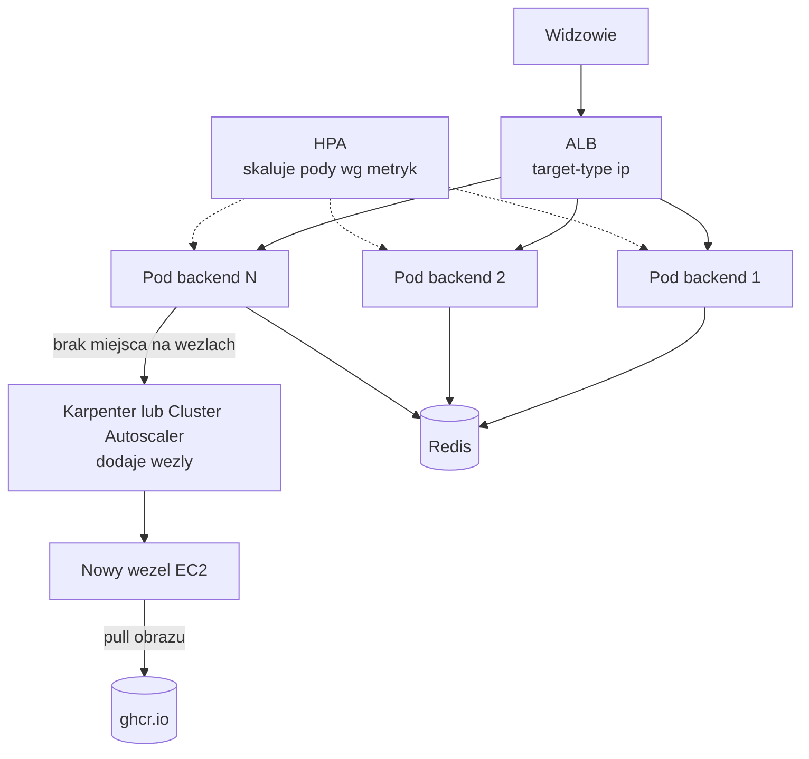
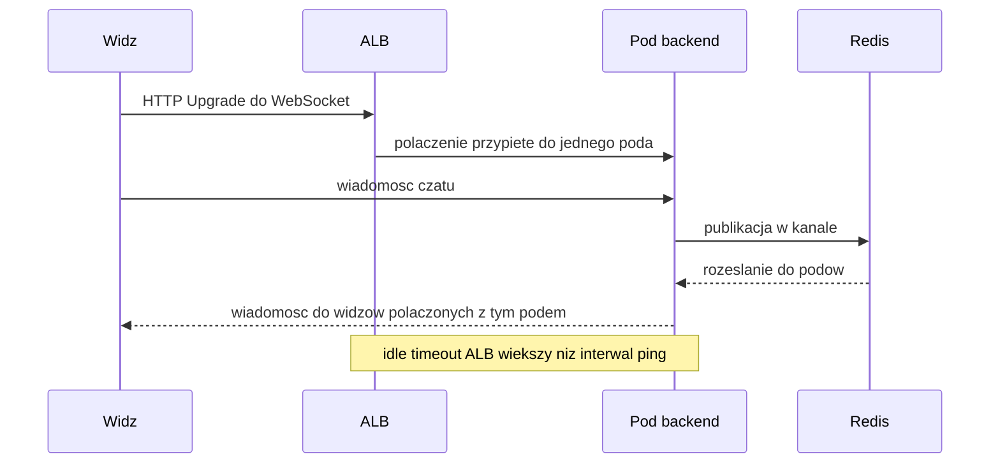

# Diagramy architektury (Mermaid)

Uzupełnienie do `wdrozenie-i-infrastruktura.md`. Diagramy robocze, przed wstawieniem do pracy trzeba je odtworzyć jako rysunki z podpisem i odesłaniem w tekście.

## 1. Układ repozytoriów i przepływ wdrożenia

## 2. Architektura platformy w AWS

## 3. Warstwy infrastruktury i granica odpowiedzialności

## 4. Sekrety i pobieranie obrazu z GHCR

## 5. Terraform w GitHub Actions i wykrywanie dryfu

## 6. Skalowanie w klastrze

## 7. Wejscie ruchu: WebSocket i SSE

